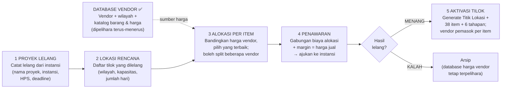
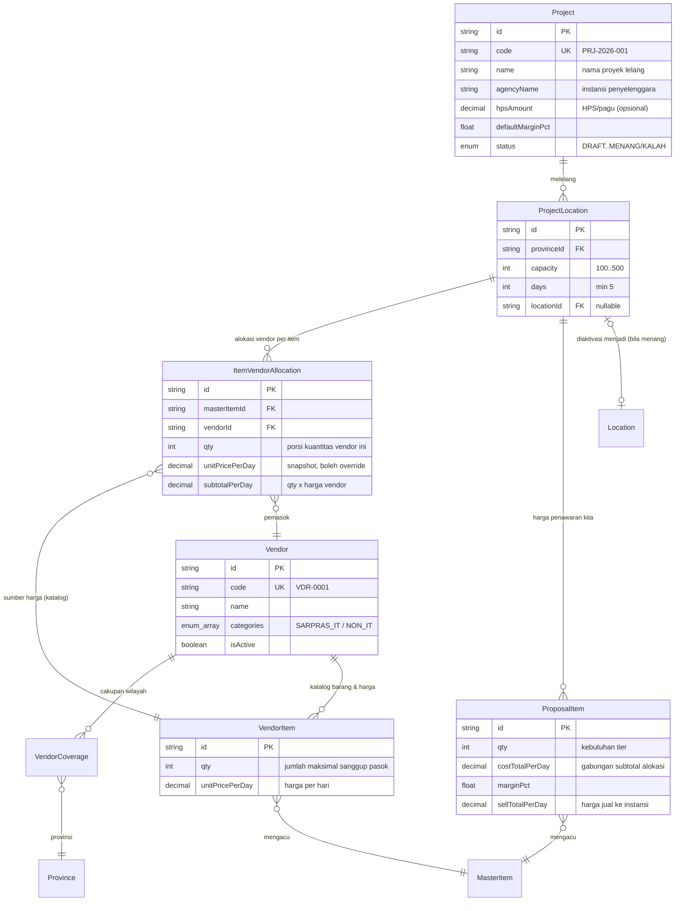

# Skema Flow Pengadaan — Lelang Instansi → Pilih Harga Terbaik dari Database Vendor → Penawaran → Tilok

> Dokumen desain untuk aplikasi **Pengelolaan & Pengendalian Pelaksanaan Seleksi**.
>
> **Posisi kita: PENYEDIA KATALOG (peserta lelang).** Instansi (BKN / K/L/PD) mengadakan lelang proyek
> seleksi CASN. Aplikasi menyimpan **database vendor rekanan beserta barang & harganya** —
> saat menyusun penawaran, kita tinggal **memilih harga terbaik per item** dari database itu,
> menambahkan margin, lalu mengajukan ke instansi. Jika **menang**, tilok dibentuk dan operasional
> berjalan dengan vendor terpilih sebagai pemasok.
>
> **Prinsip inti:**
> - vendor tersimpan untuk **semua wilayah** — satu wilayah bisa punya **lebih dari satu vendor**;
> - setiap vendor punya **katalog barang** (mengacu 38 item master) dengan **jumlah maksimal** dan
>   **harga per hari**;
> - pemilihan vendor dilakukan **per item** — tinggal pilih harga terbaik dari perbandingan;
> - satu item boleh dipasok **beberapa vendor sekaligus** (split kuantitas);
> - sistem otomatis **menggabungkan biaya** dari beberapa vendor, tetapi rinciannya tetap
>   **terpisah per vendor** — yang dijumlah adalah subtotal alokasi (qty × harga masing-masing),
>   **bukan** harga satuan antar-vendor.
>
> Acuan regulasi: Kepsesma BKN No 240 Tahun 2026 — harga satuan **per hari kegiatan**, minimal **5 hari**,
> 38 item sarpras per tier kapasitas 100–500 peserta/sesi, kategori **Sarpras IT** / **Sarpras Non IT**.

---

## 1. Alur Bisnis (5 Fase)

**Database Vendor** *(✅ sudah jadi — Fase 1)* — dikelola lepas dari proyek dan menjadi sumber harga:
menu **Pengadaan → Vendor Rekanan** (vendor, kategori IT/Non IT, cakupan provinsi, katalog barang
+ jumlah + harga per hari) dan **Pengadaan → Perbandingan Harga** (harga per item semua vendor,
urut termurah, filter wilayah & kategori).

1. **Proyek Lelang** — setiap lelang yang kita ikuti dicatat sebagai proyek bernama:
   instansi penyelenggara, tahun anggaran, HPS/pagu (bila diumumkan), jadwal seleksi,
   deadline pemasukan penawaran.
2. **Lokasi Rencana** — daftar titik lokasi yang dilelang: provinsi/kota, tier kapasitas
   (100–500 peserta/sesi), jumlah hari kegiatan (min 5 hari sesuai D.4.a Kepsesma).
3. **Alokasi Per Item** — untuk tiap item di tiap lokasi, sistem menampilkan perbandingan harga
   vendor (dari katalog, difilter cakupan wilayah & kategori) dan kita memilih pemasoknya:
   - satu vendor penuh (mis. 500 laptop semua dari CV A), **atau**
   - **split beberapa vendor** (mis. 300 laptop CV A + 200 laptop PT B — harga masing-masing);
   - tombol *"Pilih Termurah Otomatis"* mengisi semua item sekali klik, bisa diedit manual;
   - harga alokasi ter-snapshot dari katalog dan **boleh dioverride** bila vendor memberi
     harga khusus untuk proyek tersebut.
4. **Penyusunan Penawaran** — biaya per item = **gabungan subtotal alokasi** (rincian per vendor
   tetap tersimpan). Harga jual = biaya × (1 + margin). Rekap total per lokasi & proyek
   dibandingkan HPS → dokumen penawaran ke instansi.
5. **Hasil Lelang** — **MENANG**: aktivasi tilok (generate `Location` + 38 item + 6 tahapan);
   daftar vendor pemasok per item ikut terbawa ke tilok. **KALAH**: proyek diarsip —
   database harga vendor tetap terpelihara untuk lelang berikutnya.

---

## 2. ERD — Entitas & Relasinya

---

## 3. Detail Model (Prisma)

### 3.1 Sudah diimplementasi ✅ (Fase 1 — Database Vendor)

**`Vendor`** — kode auto `VDR-XXXX`, nama, `categories SarprasCategory[]` (IT/Non IT/keduanya),
NPWP/NIB/KBLI, alamat, provinsi domisili, PIC (nama/telepon/email), rating 1–5, isActive, catatan.

**`VendorCoverage`** — `(vendorId, provinceId)` unik; many-to-many wilayah↔vendor.
"Semua wilayah" = coverage seluruh provinsi (tombol *Pilih Semua Provinsi*).

**`VendorItem`** — katalog barang & harga vendor:

| Field | Tipe | Keterangan |
|---|---|---|
| `vendorId` | FK → `Vendor` (Cascade) | |
| `masterItemId` | FK → `MasterItem` (Cascade) | mengacu 38 item master |
| `qty` | Int | **jumlah maksimal** yang sanggup dipasok |
| `unitPrice` | Decimal(14,2) | **harga satuan** |
| `priceUnit` | `PriceUnit` `@default(PER_HARI)` | `PER_HARI` = dikali jumlah hari kegiatan; `PER_EVENT` = flat sekali per kegiatan (tidak tergantung jumlah hari) |
| `notes` | String? | |
| | `@@unique([vendorId, masterItemId])` | |

Validasi server: kategori item harus sesuai kategori vendor (vendor IT tidak bisa memasok barang Non IT).

> **Perbandingan lintas satuan harga** — agar harga per-hari dan per-event bisa dibandingkan
> apple-to-apple, ranking termurah dihitung dari **biaya efektif per event**:
> `PER_HARI → unitPrice × jumlahHari`, `PER_EVENT → unitPrice`. Jumlah hari bisa diatur di
> halaman Perbandingan Harga (default 5, sesuai minimal hari Kepsesma). Rumus yang sama dipakai
> di Fase 3 saat menghitung biaya alokasi per lokasi (memakai `days` lokasi tersebut).

### 3.2 Enum baru (fase berikutnya)

| Enum | Nilai |
|---|---|
| `ProjectStatus` | `DRAFT`, `PENYUSUNAN_PENAWARAN`, `DIAJUKAN`, `MENANG`, `KALAH`, `OPERASIONAL`, `SELESAI`, `DIBATALKAN` |

### 3.3 `Project` — proyek lelang yang kita ikuti

| Field | Tipe | Keterangan |
|---|---|---|
| `code` | String `@unique` | auto: `PRJ-<tahun>-<urut>` |
| `name` | String | **nama proyek** (wajib) |
| `agencyName` | String | instansi penyelenggara lelang |
| `description` | String? | |
| `fiscalYear` | Int | tahun anggaran |
| `hpsAmount` | Decimal(18,2)? | HPS/pagu — pembanding total penawaran |
| `defaultMarginPct` | Decimal(5,2) `@default(10)` | margin default %, bisa dioverride per item |
| `startDate` / `endDate` | DateTime? | periode pelaksanaan seleksi |
| `submissionDeadline` / `submittedAt` | DateTime? | batas & waktu pengajuan penawaran |
| `status` | `ProjectStatus` `@default(DRAFT)` | |
| `createdById` | FK → `User` | |

### 3.4 `ProjectLocation` — titik lokasi yang dilelang

| Field | Tipe | Keterangan |
|---|---|---|
| `projectId` | FK → `Project` (Cascade) | |
| `name` | String | nama rencana tilok (mis. "Tilok Medan") |
| `provinceId` | FK → `Province` | filter vendor yang melayani wilayah ini |
| `regencyId` | FK? → `Regency` | opsional |
| `capacity` | Int | tier 100/200/300/400/500 |
| `days` | Int | **min 5** |
| `locationId` | FK? → `Location` `@unique` | terisi saat aktivasi (menang) |

### 3.5 `ItemVendorAllocation` — alokasi vendor per item ⭐ inti pemilihan harga

| Field | Tipe | Keterangan |
|---|---|---|
| `projectLocationId` | FK → `ProjectLocation` (Cascade) | |
| `masterItemId` | FK → `MasterItem` | item yang dialokasikan |
| `vendorItemId` | FK → `VendorItem` | **sumber harga dari katalog vendor** |
| `vendorId` | FK → `Vendor` | denormalisasi untuk query & tampilan |
| `qty` | Int | **porsi kuantitas** dari vendor ini (validasi ≤ `VendorItem.qty`) |
| `unitPricePerDay` | Decimal(14,2) | snapshot dari katalog; **boleh dioverride** (harga khusus proyek) |
| `subtotalPerDay` | Decimal(16,2) | `qty × unitPricePerDay` |
| | `@@unique([projectLocationId, masterItemId, vendorId])` | beberapa baris per item = split multi-vendor |

> **Contoh split** — Laptop client peserta, kebutuhan 500 unit di Tilok Medan:
>
> | Vendor | Qty | Harga/Unit/Hari | Subtotal/Hari |
> |---|---:|---:|---:|
> | CV Sumber IT Medan | 300 | 9.000 | 2.700.000 |
> | PT Rental Komputer Nusantara | 200 | 9.500 | 1.900.000 |
> | **Gabungan (otomatis)** | **500** | — | **4.600.000** |
>
> Yang dijumlahkan adalah **subtotal alokasi** — harga satuan antar-vendor tidak pernah dijumlahkan;
> rincian per vendor tetap tersimpan per baris.

### 3.6 `ProposalItem` — harga penawaran KITA ke instansi, per item per lokasi

| Field | Tipe | Keterangan |
|---|---|---|
| `projectLocationId` | FK → `ProjectLocation` (Cascade) | |
| `masterItemId` | FK → `MasterItem` | |
| `itemName` / `unit` / `category` | snapshot | |
| `qty` | Int | kebutuhan sesuai tier |
| `allocatedQty` | Int | Σ qty alokasi — indikator lengkap bila `== qty` |
| `costTotalPerDay` | Decimal(16,2) | **otomatis**: Σ `subtotalPerDay` alokasi item ini |
| `marginPct` | Decimal(5,2) | default dari proyek, bisa per item |
| `sellTotalPerDay` | Decimal(16,2) | `costTotalPerDay × (1 + marginPct/100)`, bisa diedit (pembulatan) |
| | `@@unique([projectLocationId, masterItemId])` | |

> Rekap: total penawaran per lokasi = Σ `sellTotalPerDay × days`; total proyek = Σ lokasi,
> dibandingkan `hpsAmount`; margin aktual (Rp & %) tampil real-time.

### 3.7 Perubahan model existing

| Model | Perubahan | Alasan |
|---|---|---|
| `Location` | + `projectLocationId String? @unique` | tilok tahu asal proyek, nilai kontrak, vendor pemasok per item; nullable — tilok existing tetap valid |

---

## 4. Aturan Bisnis Kunci

1. **Kandidat vendor per item** = vendor aktif yang: kategorinya memuat kategori item,
   coverage-nya memuat provinsi lokasi, dan katalognya memuat item tsb.
2. **Min 5 hari** — `ProjectLocation.days >= 5`.
3. **Alokasi kuantitas** — Σ qty alokasi per item ≤ kebutuhan tier; qty per vendor ≤ `VendorItem.qty`
   (jumlah maksimal sanggup pasok); penawaran bisa diajukan bila semua item **teralokasi penuh**.
4. **Penggabungan biaya = Σ subtotal alokasi** — rincian per vendor selalu terpisah.
5. **Pilih Termurah Otomatis** — alokasikan kuantitas penuh ke vendor termurah per item
   (bila qty maksimalnya cukup; bila tidak, lanjut ke vendor termurah berikutnya — split otomatis);
   hasil bisa diedit manual.
6. **Snapshot** — harga alokasi & proposal disalin saat dibuat; perubahan katalog vendor setelahnya
   tidak mengubah proyek berjalan. Override harga diberi tanda (≠ harga katalog).
7. **Kunci setelah diajukan** — status `DIAJUKAN` mengunci alokasi & harga (Super Admin bisa buka kembali).
8. **Aktivasi tilok** hanya saat `MENANG`: buat `Location` + 38 item + 6 tahapan (mekanisme existing);
   alokasi menjadi **daftar vendor pemasok** tilok; status proyek → `OPERASIONAL`.
9. **Nilai kontrak per tilok** = Σ `sellTotalPerDay × days` — dasar denda 1/1000 (fase lanjutan).

---

## 5. Rencana API

### Sudah ada ✅ (Fase 1)

| Endpoint | Method | Fungsi |
|---|---|---|
| `/api/v1/vendors` | GET/POST | daftar & tambah vendor (filter `search`, `category`, `provinceId`, `includeInactive`) |
| `/api/v1/vendors/:id` | GET/PATCH/DELETE | detail / ubah / hapus |
| `/api/v1/vendors/:id/coverages` | PUT | set provinsi cakupan (replace-all) |
| `/api/v1/vendors/:id/items` | GET/PUT | katalog barang, jumlah & harga (replace-all, validasi kategori) |
| `/api/v1/vendors/items/comparison` | GET | **perbandingan harga per item antar vendor, urut termurah** (filter kategori/wilayah/nama) |

### Fase berikutnya

| Endpoint | Method | Fungsi |
|---|---|---|
| `/api/v1/projects` (+`/:id`, `/:id/status`, `/:id/locations`) | CRUD | proyek lelang & lokasinya |
| `/api/v1/project-locations/:id/activate` | POST | aktivasi tilok (hanya MENANG) |
| `/api/v1/allocations?projectLocationId=` | GET/PUT | alokasi per item (array `{vendorItemId, qty, hargaOverride?}`) |
| `/api/v1/allocations/auto-cheapest` | POST | pilih termurah otomatis per lokasi |
| `/api/v1/proposals?projectLocationId=` | GET/PATCH | harga jual + margin per item, rekap total |
| `/api/v1/projects/:id/proposal-summary` | GET | rekap seluruh lokasi vs HPS + breakdown per vendor |

---

## 6. Rencana UI

### Sudah ada ✅ (Fase 1 — grup sidebar "Pengadaan")

- **/vendors — Vendor Rekanan**: CRUD vendor, badge kategori, coverage provinsi
  (checkbox 38 provinsi + *Pilih Semua*), dialog **Barang & Harga** (centang item sesuai kategori,
  isi jumlah maksimal & harga/hari), kolom jumlah barang per vendor.
- **/price-comparison — Perbandingan Harga**: tabel 38 item × chip harga semua vendor urut termurah
  (🏆 = terbaik), filter kategori / wilayah / pencarian — dasar memilih harga terbaik saat penawaran.

### Fase berikutnya

- **/projects**: daftar proyek lelang + status + total penawaran vs HPS.
- **/projects/detail**: tab **Ringkasan** · **Lokasi** · **Alokasi Vendor** (matriks per item:
  chip harga vendor → klik untuk alokasikan qty; split multi-vendor; tombol *Pilih Termurah Otomatis*) ·
  **Penawaran** (margin & harga jual, rekap vs HPS) · **Hasil & Aktivasi**.
- **/locations/detail** (existing): + kartu "Asal Pengadaan" — proyek, instansi, nilai kontrak,
  vendor pemasok per item.

---

## 7. Tahapan Implementasi

| Fase | Lingkup | Status |
|---|---|---|
| **1. Database Vendor** | `Vendor` + `VendorCoverage` + `VendorItem`, CRUD API, halaman `/vendors` + `/price-comparison` | ✅ selesai |
| **2. Proyek Lelang** | `Project` + `ProjectLocation`, CRUD API, halaman `/projects` + detail (Ringkasan & Lokasi) | — |
| **3. Alokasi & Penawaran** | `ItemVendorAllocation` + `ProposalItem`, matriks alokasi per item, auto-termurah, margin & rekap vs HPS | — |
| **4. Hasil & Aktivasi** | status MENANG/KALAH, `Location.projectLocationId`, aktivasi tilok, kartu asal pengadaan | — |
| **5. Lanjutan** | export dokumen penawaran (PDF/CSV), riwayat harga vendor antar-proyek, dasar denda 1/1000 | — |

Semua relasi ke data existing bersifat *nullable/additive* — tiap fase bisa di-deploy terpisah
tanpa mengganggu operasional tilok berjalan.
